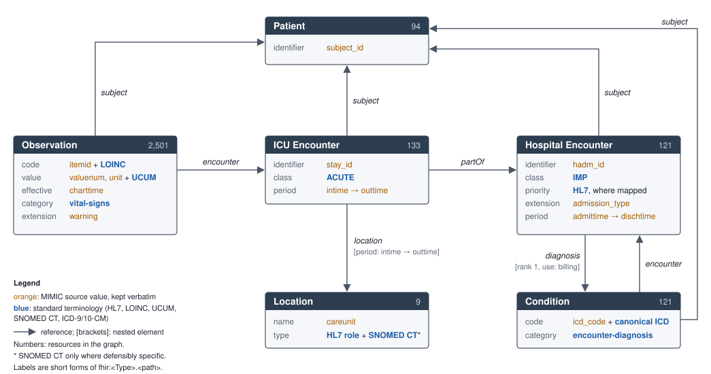

# FAIRification of a MIMIC-IV ICU Vital-Sign Extract — Report draft

Working draft, section by section, following the course report template. The authoritative report is kept separately.

## 1 Introduction

MIMIC-IV Clinical Database Demo v2.2 is an openly available, deidentified 100-patient subset of the MIMIC-IV clinical database, hosted on PhysioNet (Johnson et al., 2023; Pollard et al., 2026). MIMIC-IV contains deidentified electronic health records of patients admitted to the Beth Israel Deaconess Medical Center in Boston. Access to the full database is restricted to credentialed users, whereas the demo provides the same tabular structure at a scale suitable for teaching and preliminary work. The v2.2 archive contains 31 compressed CSV tables: 22 in the hospital module and 9 in the ICU module. It is distributed under the Open Data Commons Open Database License (ODbL) 1.0.

The demo was selected because it retains the realistic clinical data structure and source conventions relevant to ICU research while remaining small enough to FAIRify within the course.

The project resource is a reproducible extract of heart rate, respiratory rate and pulse-oximetry oxygen saturation (SpO2) observations from the first four hours of ICU stays. The four-hour cutoff is an engineering scope boundary, not a clinical claim. Each observation belongs to an ICU stay (stay_id), which is part of a hospital admission (hadm_id) of one patient (subject_id). During a stay, a patient may move through several care units in sequence, and each admission carries its first-ranked billed diagnosis. The extract is derived from seven source tables and organized as five linked tables (Table 1).

**Table 1.** The five tables of the extract.

| Table | Derived from | Records | Columns |
|---|---|---:|---|
| Observations | chartevents, d_items | 2,501 | subject_id, hadm_id, stay_id, charttime, itemid, measurement_label, valuenum, valueuom, warning |
| ICU stays | icustays | 133 | subject_id, hadm_id, stay_id, intime, outtime |
| Care-unit intervals | transfers | 167 | subject_id, hadm_id, stay_id, transfer_id, eventtype, careunit, intime, outtime |
| Hospital admissions | admissions | 121 | subject_id, hadm_id, admittime, dischtime, admission_type |
| First-ranked diagnoses | diagnoses_icd, d_icd_diagnoses | 121 | subject_id, hadm_id, seq_num, icd_code, icd_version, long_title |

Although the source dataset is already well documented, licensed and accessible, much of its meaning is encoded in MIMIC-specific identifiers, text labels, unit strings and relational conventions. For example, itemid 220045 represents heart rate because the MIMIC item dictionary defines it that way; outside the MIMIC ecosystem the code is not self-explanatory. Care units and admission types are likewise recorded as local labels.

The FAIRification therefore represents the extract as RDF aligned with HL7 FHIR R4, links local codes to shared vocabularies (LOINC, UCUM, HL7 terminology, SNOMED CT, ICD) where a defensible mapping exists, and publishes data and metadata under persistent W3IDs, described in a local FAIR Data Point, while preserving the original MIMIC identifiers and values.

## 2 FAIRification planning

### 2.1 FAIRification goals

MIMIC-IV is already FAIR at the metadata level. It has a DataCite DOI, a stated licence, documentation and open access over HTTPS. A FHIR mapping of MIMIC (MIMIC-FHIR) also already exists. The goals therefore address the data, and conversion to FHIR is not in itself claimed as a contribution. The aim is a resource that is easier to interpret, trace, combine and reuse, without losing the source-specific meaning supplied by MIMIC.

1. **Machine-actionable representation.** Represent the extract in RDF using the structures of an established clinical information model, HL7 FHIR R4. This replaces columns whose meaning is defined only in documentation. (I1)
2. **Shared vocabularies beside local codes.** Link MIMIC-local codes and labels to shared vocabularies wherever a defensible mapping exists: LOINC for measurements, UCUM for units, HL7 terminology for encounter class, admission priority and care-unit type, SNOMED CT for two care units, and canonical ICD-9-CM and ICD-10-CM codes for diagnoses. The original MIMIC values are kept next to the standard ones, and no mapping is forced where none is defensible. For ICU data, MIMIC-FHIR uses MIMIC-local code systems, and its implementation guide lists both the mapping to standard terminology and the adoption of the canonical ICD code systems as future work (KinD Lab, 2024). (I2, R1.3)
3. **Explicit clinical distinctions.** Make three distinctions machine-readable that MIMIC leaves implicit and MIMIC-FHIR does not represent:
    - the sequence of care units within an ICU stay, each with its own time interval, where MIMIC-FHIR assigns the ICU encounter its first care unit for the whole stay;
    - the class of a hospital admission, separated from its urgency, where MIMIC-FHIR places the source admission type in both;
    - the rank and billing role of the first-ranked diagnosis, so that it reads as a billing diagnosis rather than a presumed cause of admission. (I3, R1)
4. **Persistent identifiers.** Give the dataset, each of its distributions and every represented resource a globally unique, persistent and resolvable identifier. (F1, A1)
5. **Rich, findable metadata.** Describe the dataset and its distributions with machine-readable metadata, including licence and provenance, validated against a metadata schema and published in a FAIR Data Point. (F2, F3, F4, R1.1, R1.2)
6. **Reproducible derivation.** Make the path from the source release to the FAIRified resource repeatable and checkable. (R1.2)

### 2.2 Target resources

1. **The data:** the five-table extract described in Section 1, to be represented as an RDF graph.
2. **The metadata:** a description of the extract as a dataset with three distributions:
    - the source release;
    - the extract as CSV tables;
    - the extract as RDF.

The rest of the MIMIC-IV Demo is out of scope.

### 2.3 Target stakeholders

The FAIRification was carried out by the two-member project team, which covered the roles of a FAIRification project between them:

| Role | Contribution |
|---|---|
| Domain interpretation | Reading the MIMIC documentation and deciding which source meanings support a standard mapping |
| Semantic modelling | FHIR R4-aligned model and terminology mappings |
| FAIR expertise | Metadata schema and record, persistent identifiers, publication |
| Software engineering | Extraction, RDF generation and its tests, FAIR Data Point setup |

The course teacher contributed FAIR expertise from outside the team. The teacher confirmed the persistent-identifier namespace, advised publishing all three distributions, and advised documenting the semantic model with a diagram rather than an ontology file, because the model reuses existing vocabularies.

No clinical domain expert was involved. This gap was addressed by justifying each mapping from MIMIC's documentation and the terminology sources, and by leaving inexact mappings out rather than forcing them.

### 2.4 Reuse stakeholders

1. **Critical-care researchers.** Reuse goal: to compare early ICU vital signs across stays by diagnosis, care unit and admission urgency, without learning MIMIC's local codes.
2. **Data scientists developing clinical prediction models.** Reuse goal: to prototype on coded vital signs with clinical context before applying for credentialed access to the full database.
3. **Health-data integrators.** Reuse goal: to combine the extract with other clinical sources through shared codes for measurements, units and diagnoses.
4. **Educators and students** in clinical data science and FAIR data engineering. Reuse goal: a small, open, worked example of FAIRifying clinical data.

The competency questions in Section 2.7 are derived from these reuse goals.

### 2.5 FAIRification requirements

1. Represent all clinical entities with FHIR R4 resource types and predicates, and define no new classes or properties. (goal 1)
2. Keep every MIMIC identifier, code and recorded value unchanged, and add standard codes next to them rather than in their place. (goals 2, 6)
3. Add a standard code only where its meaning matches the source. Record broader classifications as broader, not as equivalents, and leave values without a defensible mapping unmapped. (goals 2, 3)
4. Represent the care-unit intervals of each ICU stay, the admission class and urgency as separate elements, and the rank and billing role of the diagnosis. (goal 3)
5. Mint persistent identifiers under the course W3ID namespace for the dataset, its distributions and every resource, built deterministically from MIMIC keys. (goal 4)
6. Describe the dataset and its distributions in DCAT, with licence, access rights and provenance. Validate the description against SHACL shapes and publish it in a FAIR Data Point. License the derived resource under ODbL 1.0, as the source licence requires for derived databases. (goal 5)
7. Generate the RDF with a script that stops on any source value outside the approved mappings, and check its output against the source. (goal 6)
8. Assert alignment with FHIR R4, not conformance, unless conformance has been validated. (goals 1, 6)

### 2.6 Semantic types

| Semantic type | Data elements |
|---|---|
| Patient | subject_id |
| Hospital admission | hadm_id, admittime, dischtime |
| Admission urgency | admission_type |
| ICU stay | stay_id, intime, outtime |
| Care unit | careunit |
| Care-unit interval | careunit, intime, outtime (per interval) |
| Vital-sign measurement type: heart rate, respiratory rate, SpO2 | itemid, measurement_label |
| Measured value and unit | valuenum, valueuom |
| Observation time | charttime |
| Warning flag | warning |
| Diagnosis | icd_code, icd_version, long_title |
| Diagnosis rank | seq_num |

The extract also keeps transfer_id and eventtype, but they are given no semantic type and are not represented in the graph.

### 2.7 Competency questions

The questions in the first group test whether the semantic model captures the structure of the source. Those in the second test whether the resource serves the reuse goals in Section 2.4.

*Structure of the data*

1. Which observations belong to a given ICU stay?
2. To which patient and hospital admission does an observation belong?
3. What does an observation measure, in MIMIC terms and in standard terms, and what are its value, unit and time?

*Reuse*

4. What is the mean heart rate in the first four hours of ICU stays, for each first-ranked billing diagnosis?
5. Which care units did each ICU stay pass through, and during which intervals?
6. How does early respiratory rate differ between emergency, urgent and elective admissions?
7. How many observations are there of each measurement type, identified by its LOINC code?
8. Which observations carry a MIMIC warning flag, and in what clinical context: measurement, value, unit, diagnosis and admission type?

## 3 FAIRification process

### 3.1 Initial FAIRness assessment

The original dataset was assessed as published on PhysioNet: the MIMIC-IV Demo v2.2 release and its metadata, consisting of the DOI with its DataCite record and the landing page with embedded schema.org JSON-LD. The criteria follow the template, extended through I1–R1.3. Each criterion is rated against the corresponding indicators of the RDA FAIR Data Maturity Model (RDA FAIR Data Maturity Model Working Group, 2020), given in brackets in the notes. A criterion is rated yes if all its indicators are met, no if none are, and partially otherwise. The ratings are a self-assessment by the project team, not an external evaluation.

**Table 2.** Initial assessment of the metadata.

| Principle | Criteria | Conformance | Note |
|---|---|---|---|
| F1 | Globally unique identifier | yes | DOI (F1-02M) |
| F1 | Persistent identifier | yes | DOI (F1-01M) |
| F2 | Has metadata | yes | DataCite record, landing page, schema.org JSON-LD |
| F2 | Has rich metadata | partially | Title, description, creators, version, date and licence, but no keywords or subjects (F2-01M) |
| F3 | Has data identifier in metadata | partially | The DOI resolves to the landing page, not to the data files (F3-01M) |
| F3 | Has data identifier with clear predicate in metadata | partially | schema:distribution points to the landing page's file list (F3-01M) |
| F4 | Indexed/registered in search resource | yes | Registered with DataCite; JSON-LD for dataset search engines (F4-01M) |
| A1 | Has resolution protocol | yes | The DOI resolves over HTTPS, to the landing page or, by content negotiation, to JSON-LD (A1-03M, A1-04M) |
| A1.1 | Protocol is open, free and universally implementable | yes | HTTPS (A1.1-01M) |
| A1.2 | Protocol has authentication and authorisation mechanisms | N/A | Open access |
| A2 | Metadata has longer persistency than data | yes | The DataCite record persists independently of PhysioNet (A2-01M) |
| I1 | Formal, accessible, shared knowledge representation | yes | schema.org JSON-LD and DataCite (I1-01M, I1-02M) |
| I2 | Uses FAIR vocabularies | yes | schema.org, DataCite (I2-01M) |
| I3 | Includes qualified references | partially | Qualified reference to the concept DOI (IsVersionOf), but no qualified reference from the metadata to the data (I3-01M to I3-04M) |
| R1 | Plurality of accurate, relevant attributes | yes | (R1-01M) |
| R1.1 | Clear, accessible data usage licence | yes | ODbL 1.0 in the JSON-LD and on the landing page, not in the DataCite record (R1.1-01M to R1.1-03M) |
| R1.2 | Detailed provenance | partially | Origin and deidentification described in text; no provenance vocabulary (R1.2-01M, R1.2-02M) |
| R1.3 | Meets domain-relevant community standards | yes | DataCite and schema.org (R1.3-01M, R1.3-02M) |

**Table 3.** Initial assessment of the data. Principles F2–F4, A2 and R1–R1.2 concern metadata only and are omitted.

| Principle | Criteria | Conformance | Note |
|---|---|---|---|
| F1 | Globally unique identifier | partially | Only the dataset as a whole has a DOI; files have plain URLs and records have local MIMIC keys (F1-02D) |
| F1 | Persistent identifier | partially | As above (F1-01D) |
| A1 | Has resolution protocol | partially | Files download over HTTPS, but the DOI resolves to a web page, not to the data (A1-03D, A1-04D, A1-05D) |
| A1.1 | Protocol is open, free and universally implementable | yes | HTTPS (A1.1-01D) |
| A1.2 | Protocol has authentication and authorisation mechanisms | N/A | Open access (A1.2-01D) |
| I1 | Formal, accessible, shared knowledge representation | no | CSV tables; meaning is defined only in column names and documentation (I1-01D, I1-02D) |
| I2 | Uses FAIR vocabularies | partially | ICD-9 and ICD-10 codes are standard; item identifiers, care-unit labels and unit strings are local (I2-01D) |
| I3 | Includes qualified references | partially | Tables are linked by foreign keys, but relationships are implicit in column names (I3-01D, I3-02D) |
| R1.3 | Meets domain-relevant community standards | partially | MIMIC's documented schema is a de facto standard in critical-care research, not a formal one (R1.3-01D, R1.3-02D) |

The metadata is already largely FAIR. The gaps are in the data: identifiers and resolution stop at the level of the dataset, and the meaning of the data depends on MIMIC-local codes and documentation rather than a formal representation.

### 3.2 Semantic data model

**Figure 1.** Resource-level semantic model.

Figure 1 shows the six resource kinds and the references between them. Every resource except Location refers to its patient. Each observation also refers to its ICU encounter, which is part of a hospital encounter. The ICU encounter refers to each care unit it passed through, and each of those references carries its own period. The hospital encounter refers to its first-ranked diagnosis, with rank 1 and the billing role. Elements in orange hold MIMIC source values, and those in blue hold standard terminology. The numbers give how many resources of each kind the graph contains.

**Concept URIs**

The model defines no classes or properties of its own. Its URIs come from three sources: FHIR R4 for classes and properties, standard terminologies for the coded values, and the MIMIC-FHIR implementation guide for the MIMIC source values.

The classes and properties are those of FHIR R4 (prefix fhir: = http://hl7.org/fhir/). The six resource kinds of Figure 1 are instances of five FHIR classes (Table 4). Every property is a FHIR R4 RDF predicate, named fhir:\<Type\>.\<element\> after the element path in FHIR's resource definitions, for example fhir:Observation.code or fhir:Encounter.location.period. Nested FHIR datatypes such as CodeableConcept, Coding, Quantity, Period and Identifier are blank nodes with their own predicates, such as fhir:Coding.system.

Coded values are recorded as FHIR Codings, each a code-system URI with a code, rather than as concept IRIs. The standard codes, shown in blue in Figure 1, come from the terminologies in Table 5. The MIMIC source values, shown in orange, keep the code and identifier systems of the MIMIC-FHIR implementation guide (base http://mimic.mit.edu/fhir/mimic/), for example CodeSystem/mimic-chartevents-d-items for item identifiers.

Where FHIR R4 has no element for a source value, the model uses FHIR extensions. An extension is FHIR's mechanism for adding a data element that the base resource does not define, and it is identified by a URL that refers to its formal definition. Two extensions carry the MIMIC warning flag, for which FHIR has no element, and the verbatim admission type, which the mapped class and priority do not preserve in full. Their URLs lie under the project's W3ID namespace and appear in the data as values, not as new classes or properties. The extensions are provisional: their URLs resolve to the project documentation rather than to formal FHIR definitions (StructureDefinitions).

**Table 4.** Classes.

| Resource | Class | Instances |
|---|---|---:|
| Patient | fhir:Patient | 94 |
| Hospital encounter | fhir:Encounter, class IMP | 121 |
| ICU encounter | fhir:Encounter, class ACUTE | 133 |
| Observation | fhir:Observation | 2,501 |
| Condition | fhir:Condition | 121 |
| Location | fhir:Location | 9 |

**Table 5.** Standard terminologies. "hl7:" abbreviates http://terminology.hl7.org/CodeSystem/.

| Used for | Vocabulary | System URI | Codes |
|---|---|---|---|
| Measurement type | LOINC | http://loinc.org | 8867-4 heart rate; 9279-1 respiratory rate; 2708-6 oxygen saturation, with 59408-5 for pulse oximetry |
| Units | UCUM | http://unitsofmeasure.org | /min; % |
| Observation category | HL7 | hl7:observation-category | vital-signs |
| Encounter class | HL7 v3 ActCode | hl7:v3-ActCode | IMP inpatient; ACUTE ICU stay |
| Admission priority | HL7 v3 ActPriority | hl7:v3-ActPriority | EL elective; UR urgent; EM emergency |
| Care-unit type | HL7 v3 RoleCode | hl7:v3-RoleCode | ICU; NS neurosurgery unit; HU hospital unit; CCU coronary care unit |
| Care-unit type | SNOMED CT | http://snomed.info/sct | 441994008 medical ICU; 418433008 surgical ICU |
| Diagnosis role | HL7 | hl7:diagnosis-role | billing |
| Condition category | HL7 | hl7:condition-category | encounter-diagnosis |
| Diagnosis | ICD-9-CM, ICD-10-CM | http://hl7.org/fhir/sid/icd-9-cm, http://hl7.org/fhir/sid/icd-10-cm | Canonical dotted codes, e.g. 414.01 |

The model was compared with MIMIC-FHIR element by element, using the mapping tables, profiles and examples of its implementation guide (KinD Lab, 2024). The resource types, statuses, the ICU encounter's partOf link, the encounter-diagnosis category and the identifier systems follow MIMIC-FHIR. They are therefore not claimed as contributions. Table 6 lists the choices where the model differs.

**Table 6.** Modelling choices that differ from MIMIC-FHIR for the scoped data.

| Modelling choice | MIMIC-FHIR | This model | Listed as future work in the IG |
|---|---|---|---|
| *Terminology* | | | |
| Measurement code, unit and category of ICU observations | MIMIC item code; source unit string as both unit and code; MIMIC category | MIMIC item code plus LOINC; source unit plus UCUM; HL7 vital-signs category | Yes: mapping MIMIC terminology to US Core terminology |
| Diagnosis code | MIMIC-specific ICD-9 and ICD-10 code systems | MIMIC code plus canonical ICD-9-CM or ICD-10-CM code | Yes: canonical ICD code systems, intended to replace the MIMIC ones; here they are added alongside |
| Care-unit type | Name only, with a fixed physical type "ward" | HL7 role code as a broader classification, plus a specific SNOMED CT code for the medical and surgical ICUs | No |
| *Clinical distinctions* | | | |
| Care units within an ICU stay | First care unit for the whole stay; the full transfer history is kept on the hospital encounter only | Each care-unit interval on the ICU encounter, with its own period | No |
| Admission class and urgency | Verbatim admission type in both class and priority | Class inpatient (IMP); priority from HL7 where defensible (elective, urgent, emergency); verbatim admission type kept as an extension | No |
| First-ranked diagnosis | Condition linked to its encounter; seq_num used only to build the identifier | Encounter.diagnosis with rank 1 and the billing role | No |

### 3.3 Data triplification

_To do._

### 3.4 Semantic metadata model

_To do._

### 3.5 Metadata and data publication

_To do._

### 3.6 Final FAIRness assessment

_To do._

## 4 Discussion and conclusions

_To do._

## Annexes

### References

Johnson, A., Bulgarelli, L., Pollard, T., Horng, S., Celi, L. A., & Mark, R. (2023). *MIMIC-IV Clinical Database Demo* (version 2.2). PhysioNet. RRID:SCR_007345. https://doi.org/10.13026/dp1f-ex47

KinD Lab. (2024). *MIMIC Implementation Guide* (version 1.3.0, draft). HL7 FHIR R4. https://kind-lab.github.io/mimic-fhir/

Pollard, T., Moody, B. E., Lehman, L., Gow, B., Fernandes, C., Xie, C., Johnson, A., Mark, R. G., & Heldt, T. (2026). PhysioNet as a global platform for biomedical research. *Nature Health*. https://doi.org/10.1038/s44360-026-00096-z

RDA FAIR Data Maturity Model Working Group. (2020). *FAIR Data Maturity Model: Specification and guidelines*. Research Data Alliance. https://doi.org/10.15497/RDA00050
